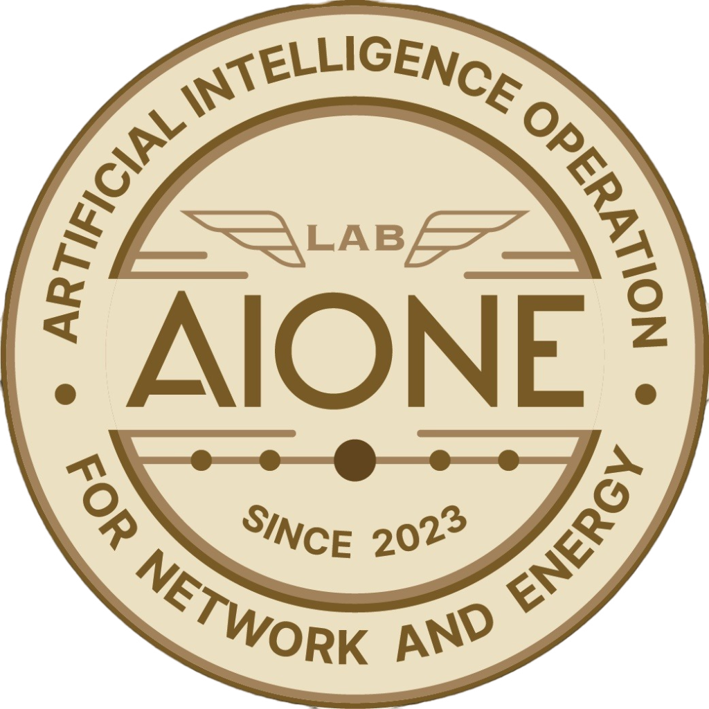

# AIONE LAB - Official Branding & 2026 Recruitment Website
> **대전대학교 컴퓨터공학 인공지능 연구실 (AIONE LAB)**  
> **Artificial Intelligence Operation for Network and Energy · SINCE 2023**  
> 공식 브랜딩 및 2026학년도 신규 연구원(학부연구생 6기 & 석사 신입생) 모집 웹사이트

<p align="center">
  
</p>


---

## 🔬 3대 핵심 연구 분야 (Core Research Areas)
1. **AI 예지 보전 (AI Predictive Maintenance)**: 산업 설비·에너지 고장 사전 예측, 시계열 센서 이상 탐지(Anomaly Detection) 및 잔여 수명(RUL) 예측
2. **의료 AI (Medical AI)**: 의료 영상(X-ray, CT, MRI) 컴퓨터 비전 판독 및 병변 분할, 생체 신호(ECG/PPG) 분석, 임상 의사결정 보조(CDSS)
3. **자율주행 (Autonomous Driving)**: 센서 퓨전(LiDAR, Radar, Camera), 3D 객체 인식, 주행 경로 예측(Path Planning), 실시간 엣지 제어 최적화

---

## 🌟 주요 특징 (Key Features)

### 1. Futuristic Tech & AI Aesthetic
- **신경망 입자 인터랙션 (`canvas.js`)**: 마우스 커서 및 터치에 반응하며 유기적으로 연결되는 노드-에지 신경망 시뮬레이션 (60fps)
- **글래스모피즘 & 사이버 랙 UI**: 고해상도 글래스모피즘(Backdrop Blur) 및 실시간 작동 램프(Online Pulse)가 적용된 서버 스펙 카드
- **다크 / 라이트 모드 완벽 지원**: 사용자 OS 환경 감지 및 수동 토글 지원, 로컬 스토리지에 테마 상태 저장
- **사이드 토글 네비게이션 드로어 (Off-Canvas Sidebar) & 플로팅 퀵 컨트롤**: 
  - 상단 헤더 우측의 **[MENU ☰]** 버튼 클릭 시 우측에서 스르륵 열리는 프리미엄 사이드 드로어 메뉴 (홈, 소개, 서버 스펙, 연구진, 지원 혜택, 2026 지원서 작성, 문의 오픈채팅방, 공식 사이트)
  - 딤 배경(Backdrop Blur) 클릭, 닫기 버튼(✕), ESC 키, 메뉴 링크 클릭 시 부드러운 스크롤 이동 및 자동 닫힘
  - 스크롤 시 우측 하단에 나타나는 원클릭 **[▲ TOP]** 플로팅 네비게이션 버튼
  - 브라우저 스크롤 복원 간섭을 배제하고 링크 접속 시 **항상 최상단(메인 엠블럼·히어로)에서 깔끔하게 시작**하도록 보장하는 스마트 스크롤 제어 로직 탑재

### 2. 연구실 공식 링크 및 대외 연동
- **AIONE LAB 문의 오픈채팅방**: [https://open.kakao.com/o/gHO1VCMi](https://open.kakao.com/o/gHO1VCMi) (지원서 작성 및 연구실 활동 실시간 Q&A)
- **연구실 공식 Google Site**: [https://sites.google.com/view/aionelab/education?authuser=0](https://sites.google.com/view/aionelab/education?authuser=0)
- **논문/특허 실적 확인**: [https://sites.google.com/view/aionelab/publications?authuser=0](https://sites.google.com/view/aionelab/publications?authuser=0)
- **랩장 개인 포트폴리오**: [https://och7905.github.io/Personal_Website_Deployment/](https://och7905.github.io/Personal_Website_Deployment/)
- **위치 지도 연동**: 카카오맵 및 네이버 지도 대전대학교 서문(융합과학관) 바로가기 연결

### 3. 연구진 (학부연구생 트랙)
- **전승현 지도교수**: 융합과학관 330호 (creemur@dju.kr / 042-280-2544)
- **오창현**: 랩장 (학부연구생 3기, 22학번 | AI & 백엔드)
- **권관우**: 학부연구생 3기 (22학번 | AI & NLP / 딥러닝)
- **김지은**: 학부연구생 4기 (25학번 | 교직이수 & AI)
- **장윤민**: 학부연구생 5기 (26학번 | 컴퓨터공학 학사과정)

### 4. 연구 인프라 & 하드웨어 스펙 시각화
- 연구원 전원에게 **독립 GPU 클러스터 개인 계정** 발급
- **Windows 연구 워크스테이션 서버**: Intel Xeon w5-3433 | 64GB ECC | NVIDIA RTX PRO 6000 Blackwell Max-Q 96GB | Dell 006CX9
- **Linux 고성능 클러스터 서버**: AMD EPYC 9124 16-Core | 128GB ECC | NVIDIA RTX A4000 × 2 | ASUS K14PG-D24 Series

---

## 📝 2026 연구원 지원서 시스템 (#apply)

### 1. 입력 필드 구성 및 제약 조건
1. **기본 인적사항**:
   - 성명
   - 학번 (숫자만 입력 허용, 영문/한글 원천 차단, 최대 10자리)
   - 지원 구분 및 학년 (1학년 예비 2학년 6기 / 2학년 / 3학년 / 4학년 / 석사 진학 희망자)
   - 전화번호 (숫자만 입력 허용, `010-XXXX-XXXX` 실시간 자동 하이픈 기입)
   - 병역 구분 (군필 / 미필 / 면제 / 해당없음)
2. **자기소개 및 학업 의지 (실시간 글자수 카운터 및 글자수 제한)**:
   - 단어 소개: 본인을 가장 잘 나타낼 수 있는 '단어'와 그 이유 (자기소개)
   - 지원동기: AIONE LAB 지원동기 (최대 500자 제한)
   - 문제해결 경험: 인생에서 힘든 문제를 주도적으로 해결한 경험 및 배운 점 (최대 500자 제한)
   - 학업 계획: 연구원으로서의 학업 계획 (최대 200자 제한)
   - 얻고자 하는 것: 연구실에서 얻고자 하는 역량 및 경험 (최대 200자 제한)
   - 졸업 후 진로 계획: 졸업 후 희망 진로 방향 (최대 200자 제한)
3. **기술 스택 & 희망 트랙 & 면접 일정 (인터랙티브 선택 블록)**:
   - 기술 스택: Python, PyTorch, TensorFlow, C/C++, Java, JS/TS, Linux, Git, FastAPI, Docker, OpenCV (스카이블루 네온 활성화 + 텍스트창 양방향 동기화)
   - 희망 연구 트랙: AI 예지 보전, 의료 AI, 자율주행, GPU/MLOps 인프라, 컴퓨터 비전, 자연어처리(NLP) (에메랄드 활성화)
   - 면접 일정: 요일 블록(월~금, 주말, 평일 상시) + 시간대 블록(오전, 오후A, 오후B, 저녁, 시간대 협의) (사이버 퍼플 활성화)
4. **포트폴리오 및 증빙 자료 제출 안내**:
   - Google Drive 링크 (링크가 있는 모든 사용자 보기 권한) / GitHub / Notion URL 입력 지원
   - 랩장 메일(`och7905@naver.com`) 직접 첨부 발송 안내 완비

---

## 📄 공식 지원서 양식 A4 2-Page 정밀 PDF 실시간 생성 & 전송 시스템

### 1. 공식 입실 지원서 양식 PDF 자동 생성 (Zero-Clipping 2-Page Architecture)
- 지원서 접수 버튼 클릭 시 `html2pdf.js` 엔진을 통해 지원자의 모든 응답이 기재된 **공식 대학교 연구실 입실 지원서 양식**이 실시간 컴파일됩니다.
- 가상 윈도우 스케일링 오프셋을 전면 제거하고 A4 정밀 규격(`750px` / `210mm × 297mm`)과 명시적 페이지 분할(`.html2pdf__page-break`)을 적용하여 **좌측 및 하단 잘림(Clipping)이 전혀 없는 완벽한 2장짜리 공식 지원서 PDF**를 생성합니다.
- 지원자 컴퓨터(다운로드 폴더)에 **`AIONE_2026_지원서_{학번}_{이름}.pdf`** 파일이 자동 다운로드됩니다.
- **페이지별 구성 요소**:
  - **Page 1 (첫 번째 장)**:
    - 대전대학교 컴퓨터공학 AIONE LAB 공식 엠블럼 로고 및 문서 접수 헤더
    - 대제목: 2026학년도 신규 연구원 입실 지원서 (학부연구생 6기 & 석사과정)
    - 1. 기본 인적사항 정식 테이블 (성명, 학번, 지원구분/학년, 전화번호, 병역 구분, 연구실 위치)
    - 2. 기술 스택 및 면접 일정 테이블 (프로그래밍 경험, 희망 연구 트랙, 면접 가능 시간대, 포트폴리오 링크)
    - 3. 자기소개 및 지원동기 (가. 본인을 가장 잘 나타내는 단어, 나. 지원동기 500자)
    - 하단 페이지 번호: `- 1 / 2 -`
  - **Page 2 (두 번째 장)**:
    - 공식 서브 헤더 (지원자 성명 및 학번 식별 헤더)
    - 연구 역량 및 학업·진로 계획서 (다. 문제해결 경험 500자, 라. 학업 계획 200자, 마. 얻고자 하는 것 200자, 바. 졸업 후 진로 계획 200자)
    - 하단 정식 서약문: "본 지원서에 기재된 모든 사항은 사실과 다름없음을 서약하며..."
    - 접수 일자, 지원자 성명, 정식 (인/서명) 날인 영역
    - 하단 페이지 번호: `- 2 / 2 -`

### 2. 이메일 전달 시스템
- **Formspree 실시간 비동기(AJAX) 병렬 전송**:
  - 엔드포인트: `https://formspree.io/f/mzeevple`
  - 메일 제목: `[AIONE LAB 2026 연구원 지원서] {이름} ({학번} / {학년})`
  - 스팸 필터링 방지를 위해 `email` 및 `_replyto` 발송자 식별 헤더를 페이로드에 명시하여 랩장 메일(`och7905@naver.com`)로 신뢰도 높게 수신
  - **독립 병렬 실행(Concurrent Execution)**: PDF 생성/다운로드와 Formspree 전송을 `Promise.all`로 병렬 처리하여, 다운로드 창이나 지연과 상관없이 메일이 즉시 발송되도록 보장
- **Google Apps Script Web App 연동 지원 (선택 옵션 - 실제 PDF 파일 첨부 발송)**:
  - Formspree 무료 플랜의 파일 첨부 제약을 극복할 수 있도록, 100% 무료 Google Apps Script 웹앱 연동 기능을 내장(`js/form.js` 내 `GOOGLE_APPS_SCRIPT_URL`).
  - Google Apps Script를 배포하여 URL을 입력하면, Gmail API를 통해 **실제 `.pdf` 파일이 첨부된 이메일**이 랩장 메일함으로 100% 무료 자동 발송됩니다.
- **제출 성공 시 UX**:
  - 공식 PDF 자동 다운로드 및 백업 JSON(`AIONE_지원서_{학번}_{이름}.json`) 로컬 동시 보관
  - 접수 완료 모달창 내 **[✉️ 다운로드된 PDF를 랩장 메일로 직접 전달하기]** 원클릭 연동 버튼 제공
  - 네이버 메일 수신 시 스팸 메일함 확인 안내 메시지 제공
  - 폼 초기화 및 로컬스토리지 임시 저장 데이터 정리
- **임시 저장(Draft Autosave)**:
  - 작성 중 브라우저 로컬스토리지에 실시간 자동 임시 저장되어 새로고침 후에도 작성 내용 및 선택 블록 상태 복원

---

## 📂 프로젝트 구조 (Directory Structure)

```
AIONE LAB/
├── index.html              # 메인 SPA 웹페이지 (신경망 캔버스, 서버스펙, 연구진, 지원서, 사이드 드로어, PDF 템플릿)
├── css/
│   └── style.css           # 글래스모피즘, 사이드 드로어, 네온 인터랙션, 다크/라이트 테마, 선택 블록 스타일
├── js/
│   ├── canvas.js           # 인터랙티브 신경망 입자 캔버스 (60fps)
│   ├── main.js             # 사이드 토글 네비게이션 드로어, 최상단 시작 스크롤 제어, 테마 토글, 모달 제어
│   └── form.js             # 지원서 검증, PDF 실시간 생성/다운로드, Formspree & GAS 메일 연동
├── assets/
│   └── logo.png            # AIONE LAB 공식 엠블럼 고해상도 로고
├── server.ps1              # 무설치 경량 로컬 웹서버 스크립트 (캐시 방지 헤더 탑재)
├── start-server.bat        # 로컬 웹서버 원클릭 실행 배치 파일
└── README.md               # 프로젝트 공식 문서
```

---

## 🚀 실행 및 배포 방법 (How to Run & Deploy)

### 1. 로컬 환경에서 원클릭 실행
- 별도의 Node.js나 Python 설치 없이, 폴더 내 **`start-server.bat`** 파일을 더블 클릭하면 PowerShell 로컬 서버가 구동되며 기본 브라우저(`http://localhost:8080/`)가 자동으로 열립니다.

### 2. GitHub Pages 배포 (추천)
1. GitHub 저장소(Repository)에 프로젝트 파일 전체를 푸시합니다.
2. 저장소의 `Settings` > `Pages` 메뉴로 이동합니다.
3. `Branch`를 `main` 또는 `master`의 `/(root)`로 지정 후 `Save`를 클릭합니다.
4. 약 1분 후 `https://<github-id>.github.io/<repo-name>/` 주소로 전 세계 어디서나 접근 가능한 고속 정적 웹사이트로 배포됩니다.

### 3. Vercel 또는 Netlify 배포
- 저장소를 연동하거나 폴더를 드래그 앤 드롭하는 것만으로 빌드 설정 없이 즉시 글로벌 CDN에 배포됩니다.

---

## ⚙️ Google Apps Script를 통한 실제 PDF 첨부 메일 자동화 설정법 (무료)

Formspree 무료 플랜 대신 **네이버 메일에 실제 `.pdf` 파일이 직접 첨부되어 오도록** 만들고 싶으신 경우 아래 3단계를 진행하시면 됩니다:

1. [Google Apps Script (script.google.com)](https://script.google.com/) 접속 후 **새 프로젝트** 생성
2. 아래 코드를 붙여넣고 저장:
```javascript
function doPost(e) {
  var data = JSON.parse(e.postData.contents);
  var pdfBlob = Utilities.newBlob(
    Utilities.base64Decode(data.pdfBase64), 
    'application/pdf', 
    data.filename || ('AIONE_2026_지원서_' + data.student_id + '_' + data.name + '.pdf')
  );

  MailApp.sendEmail({
    to: 'och7905@naver.com',
    subject: '[AIONE LAB 신규 지원서 PDF] ' + data.name + ' (' + data.student_id + ' / ' + data.grade + ')',
    body: 'AIONE LAB 2026학년도 신규 연구원 지원서 PDF가 첨부되었습니다.\n\n' +
          '지원자: ' + data.name + ' (' + data.student_id + ' / ' + data.grade + ')\n' +
          '연락처: ' + data.phone + '\n' +
          '제출일시: ' + new Date().toLocaleString('ko-KR') + '\n\n' +
          '(첨부된 PDF 파일을 확인해 주세요)',
    attachments: [pdfBlob]
  });

  return ContentService.createTextOutput(JSON.stringify({ status: 'success' })).setMimeType(ContentService.MimeType.JSON);
}
```
3. 우측 상단 **[배포] > [새 배포]** 클릭:
   - 유형: **웹 앱(Web App)**
   - 액세스 권한: **모든 사용자(Anyone)** 선택 후 배포
4. 발급된 **웹 앱 URL**을 복사하여 [`js/form.js`](file:///c:/Users/오창현/Desktop/AIONE%20LAB/js/form.js) 상단의 `GOOGLE_APPS_SCRIPT_URL`에 넣어주시면 설정이 완료됩니다.

---

## 📞 연구실 정보 및 문의처 (Contact)

- **연구실 위치**:
  - **AIONE LAB 학생 연구실**: 대전광역시 동구 대학로 62 (대전대학교 서문 방면 융합과학관 217호)
  - **전승현 지도교수 연구실**: 대전대학교 서문 방면 융합과학관 330호
- **지도교수**: 전승현 교수 (대전대학교 컴퓨터공학 학회장 / 사물인터넷(IoT))
  - 연구실: 융합과학관 330호
  - 직통전화: 042-280-2544 (교내 구내전화: 2544)
  - 이메일: [creemur@dju.kr](mailto:creemur@dju.kr)
- **랩장**: 오창현 (3기, 22학번)
  - 연구실: 융합과학관 217호
  - 이메일: [och7905@naver.com](mailto:och7905@naver.com)
  - 연락처: 010-9347-7906
  - 개인 웹사이트: [https://och7905.github.io/Personal_Website_Deployment/](https://och7905.github.io/Personal_Website_Deployment/)
- **실시간 문의**:
  - **AIONE LAB 문의 오픈채팅방**: [https://open.kakao.com/o/gHO1VCMi](https://open.kakao.com/o/gHO1VCMi) (지원서 작성 및 연구실 관련 실시간 Q&A)
